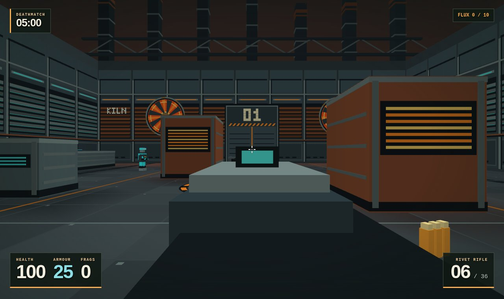

# BOOMER-SHOOTER — THE FOUNDRY PIT

**ONE OPERATOR. THREE RIVAL MACHINES. ONE ARENA.**

An original, fast, offline-first industrial arena FPS built with [QSOLKCB/VANILLAJS v3.2.0](https://github.com/QSOLKCB/VANILLAJS/releases/tag/v3.2.0). Play against **Kiln**, **Vise** and **Flux** in a real free-for-all: the machines hunt, fight and eliminate *one another*, not just you.

[**Play the game**](https://qsolkcb.github.io/Boomer-Shooter/) · [Release notes — proposed v0.1.0](RELEASE_NOTES_v0.1.0.md) · [Development roadmap](ROADMAP.md) · [Verification evidence](evidence/bs-002/README.md)



> **Implementation:** BS-001 and BS-002 are merged. **Release status:** v0.1.0 is proposed, not yet tagged. The game is publicly playable on GitHub Pages; owner acceptance and native GPU profiling remain separate checks.

## Play now

**Browser:** [qsolkcb.github.io/Boomer-Shooter/](https://qsolkcb.github.io/Boomer-Shooter/)

Select **Enter the pit** to request mouse capture in the same click that starts the match. The arena, bots and clock remain frozen while capture is pending; the entry click cannot accidentally fire a shot. If your browser declines pointer lock, try the arena again or choose **Play without capture** for drag/arrow-key aiming. Keyboard activation of the entry button works without mouse capture.

The default match is **one human versus three CPU rivals**, first to **10 frags** or the highest score after **five minutes**. Every combatant can win. Self-eliminations give no frag; ties use fewer deaths and then a stable ID.

| Machine | Style | Weapon |
| --- | --- | --- |
| **Kiln** | Aggressive, closes distance | **Arc Repeater** — automatic |
| **Vise** | Uses cover and precise sightlines | **Rivet Rifle** — precision hitscan |
| **Flux** | Mobile patrol and area pressure | **Slag Launcher** — travelling explosive shot |

The arena has a central casting floor, cover, a west gantry and contested health, armour and ammunition supplies. The Slag Launcher can inflict self-damage. A frag feed, live scoreboard, incoming-damage indicator and match results show the consequences of actual combat events.

## Controls

| Input | Action |
| --- | --- |
| **W A S D** / **Shift** | Move and strafe / sprint |
| **Mouse** or **arrow keys** | Look; drag to look in uncaptured mode |
| **Left click** / **F** | Fire (tap rifle/launcher; hold repeater) |
| **Right click** / **Q** | Hold sights for narrower FOV and finer aim |
| **Space** | Jump; Arcade mode supports a short pre-landing jump buffer |
| **R** | Reload |
| **1 / 2 / 3** | Rivet Rifle / Arc Repeater / Slag Launcher |
| **Tab** | Hold live scoreboard |
| **P / Escape** | Pause; Escape releases mouse capture |
| **Rematch** | Begin a fresh match |

**Options** offers **Arcade or Classic** movement, **Easy/Normal/Hard** CPU opponents, mouse sensitivity/invert Y, native or 70% render scale, adjustable frag and time limits and opt-in procedural audio. The sound starts muted. Health pads recharge after **9 seconds** and ammo after **6 seconds** of simulation time. Pads do not refill ammunition that is already full.

## Run locally — no npm installation

With Python 3 and a modern WebGL-capable browser:

```sh
git clone https://github.com/QSOLKCB/Boomer-Shooter.git
cd Boomer-Shooter
python3 -m http.server 8000 --bind 127.0.0.1
```

Open **http://127.0.0.1:8000/**. The browser game uses native ES modules and locally packaged assets. A network connection is not required after cloning, but the local HTTP server **must remain running for cold starts and reloads**. Opening `index.html` directly with `file://` is not supported. The project does **not** install a service worker, and a fresh browser load is not available without an HTTP origin.

## Real engine integration

The project vendors the bounded public-module closure from **VANILLAJS v3.2.0 — SEDIMENT & SIGNAL** at immutable commit:

```text
7a3a5a3ec49aed5b7063a05614951e69bb257da6
```

The engine provides the character controller, fixed time, input, collision, projectiles, Combat3D damage/attribution, weapon feel, navigation primitives and WebGL1 rendering. The *game* owns its arena, CPU decision-making, match rules, presentation, UI and replay format. Original procedural graphics and locally generated audio do not depend on a remote asset service.

The only approved consumer derivative is the documented **Combat3D armour pickup** extension. See [engine integration](docs/ENGINE_INTEGRATION.md) and the [per-file vendoring manifest](vendor/vanillajs/manifest.json). Do not silently upgrade to VANILLAJS `main` or treat demo code as a public API.

Gameplay advances at **60 authoritative simulation ticks per second** with a five-step catch-up cap. Render frames, visual effects and audio do not define combat outcomes. The recorded replay format binds the accepted commands, seed, movement and difficulty rules to the match state. **BS-002 replays can read BS-001 tapes.** Same-runtime verification is supported; the archived Node and Chromium Float64 hashes are **not** cross-runtime identical.

From pause or results, choose **Save command replay**. To verify it, use **Options → Verify saved replay** in the **same browser environment** that produced the tape.

## Test and package

Node is used for developer verification, **not** as a browser runtime dependency:

```sh
node --test tests/*.test.mjs
node scripts/verify-replay.mjs evidence/bs-001/node-reference-replay.json
(cd evidence/bs-002 && sha256sum -c SHA256SUMS)
```

To package into a fresh, empty directory:

```sh
python3 scripts/package_pages.py /tmp/foundry-site
python3 -m http.server 8001 --bind 127.0.0.1 --directory /tmp/foundry-site
```

For **actual Chromium interaction and replay evidence**, install Python Playwright separately (testing only), provide a Chromium binary and run:

```sh
python3 scripts/browser.py --chromium /path/to/chromium --suite all --out /tmp/foundry-evidence
```

The [Pages workflow](.github/workflows/pages.yml) runs the consumer tests and packages the complete static runtime. Deployment is restricted to reviewed `main`; the merge of BS-002 has a [successful Pages workflow](https://github.com/QSOLKCB/Boomer-Shooter/actions/runs/45036209648).

## Performance: measured, not assumed

The [BS-002 evidence record](evidence/bs-002/README.md) documents a **1920×1080** browser drawing buffer using **Chrome Headless Shell 151 / ANGLE Vulkan SwiftShader (software rendering)**, as well as a played deathmatch, actual bot-versus-bot frags and verified replays. In that software reference, BS-002 Arcade recorded **p50/p95 render callback intervals of 100.1/250.0 ms** and **p50/p95 individual simulation steps of 1.0/5.4 ms**.

Those numbers describe **that measured hosted run only**. They are *not* native GPU timing, a proven speedup over BS-001 or evidence of 1080p/60 FPS on physical hardware. The CPU and software renderer were shared, and the comparison rulesets behaved differently. See the [raw frame and tick samples](evidence/bs-002/README.md#1080p-reference).

The recorded BS-002 execution passed **28 consumer tests** on Node 24.22.3, verified browser replay in the producing Chromium environment, and exercised repeated match teardown. Manual mouse-feel/audio assessment, native GPU testing, other browser families and an eight-bot stress ladder remain open.

## Experimental next game — STORM PROTOCOL (proposal)

Imagine the foundry floor becoming a 3D bullet-hell arena: **one human versus a giant reactor boss**, threading real, damaging radial rings, spirals and sweeping walls of neon projectiles. The existing Deathmatch stays untouched.

This is a **planning proposal, not a playable mode**. [Read the design and engineering limits](docs/BULLET_HELL_001.md) · [ChatGPT Work implementation handoff](docs/BULLET_HELL_WORK_HANDOFF.md). The engine's Combat3D combat pool remains capped at 64 live projectiles; higher-density patterns require a separately tested bounded authority and honest GPU measurements.

## Documentation and next work

| Document | Purpose |
| --- | --- |
| [Roadmap](ROADMAP.md) | BS-000 through BS-006, with BS-003 arena expansion next |
| [AGENTS.md](AGENTS.md) | Repo policy, pinned APIs and review gates |
| [Game design](docs/GAME_DESIGN.md) | Arena, weapons, bot personalities, match rules |
| [BS-002 engineering notes](docs/BS_002.md) | Arcade handling, capture gate, impacts, bot skill, supply tuning |
| [Acceptance](docs/ACCEPTANCE.md) / [Performance](docs/PERFORMANCE.md) | Behavioral gates and measurement rules |
| [BS-001 evidence](evidence/bs-001/README.md) / [BS-002 evidence](evidence/bs-002/README.md) | Reproduction logs, screenshots, match receipts and hardware caveats |
| [Original ChatGPT Work handoff](docs/WORK_HANDOFF.md) | Historical implementation brief |
| [Credits](CREDITS.md) / [Provenance](docs/PROVENANCE.md) | Original game content and upstream licensing |

**QSOL-IMC — THIS IS NOT A PRODUCT. THIS IS INDEPENDENCE.**

Apache-2.0. Original game content and included source are covered by the repository licence; vendored VANILLAJS licence and notices remain in `vendor/vanillajs/`.
