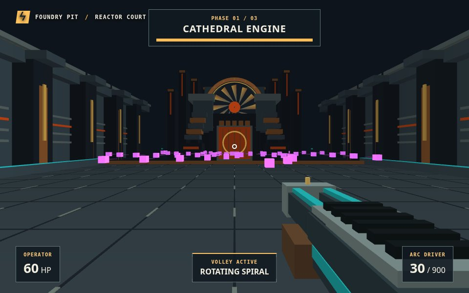

# Cathedral Engine / packaged browser evidence

Runtime commit `be8781933c2c208cc0b0158e9a8ffc5b5ef1456b`, based on the merged BH-001A at `fe51a66682f80f8204682d01f5addf44d502e58f`. Both new and existing games were served locally under `/Boomer-Shooter/`. The browser reports record the runtime file digest, exact Chromium binary hash and host. First-party geometry and sound sources are listed in [CREDITS](../../CREDITS.md). The upstream module closure and individual hashes are in the [VANILLAJS receipt](../../vendor/vanillajs/manifest.json).



## Play and lifecycle

The [browser run](browser.json) used real keyboard and pointer input. After warm-up the browser went offline. Moving right in response to the opening fan kept the operator at 100 HP. The stationary control took damage. The [defeat tape](defeat-replay.json) exhausted operator HP at tick 780. On restart the Arc Driver destroyed the core in phase three at tick 633, with 40 operator HP remaining. [Victory tape](victory-replay.json) · [Defeat screen](operator-down.jpg) · [Victory screen](core-offline.jpg)

The game replayed the winning commands at 70% render scale. Both recordings also passed independent re-execution in their producing Chromium runtime. The probe exercised denied capture, drag look, captured keyboard aim, focus loss, release outside the game, pointer unlock, a simulated hidden-tab event, unsupported WebGL and real context loss/restoration. Across ten alternating mode transitions, teardown returned every tracked WebGL buffer/program, active voice, scheduled game frame and game-registered input/lifecycle listener in the probe to zero. Headless mouse capture does not assess physical mouse feel. The audio path was exercised without a listening assessment.

The [Deathmatch browser regression](deathmatch-browser.json) covers the original match, opening frag, scoreboard, pointer capture gate, fallback and restarts. All [34 Node tests](tests.log) passed. The [4,220-tick archive replay](deathmatch-replay.json) reproduced both SHA-256 digests. The BS-002 archive also passed its [checksum check](archive.log).

## Authoritative hazard workload

Chrome Headless Shell 151.0.7922.34, ANGLE Vulkan SwiftShader, 1280 × 720, device scale 1, seed 1398034258. Each fixed-occupancy fixture loaded real hazards through the bounded emitter in batches, then ran the normal full encounter tick, including swept contacts, replay digest and scene rendering. Every measured tick checked and every draw submitted the named occupancy. When full, the field rejected the normal encounter's additional emissions. The numbers describe the fixture, independently of peak occupancy in an ordinary boss fight.

| Live hazards | Tick p50 / p95 / p99 (ms) | Frame interval p50 / p95 / p99 (ms) | Scene draw calls | Dropped seconds |
| ---: | --- | --- | ---: | ---: |
| 64 | 0.2 / 0.4 / 0.5 | 33.2 / 33.4 / 50.0 | 5 | 0 |
| 128 | 0.2 / 0.4 / 0.6 | 33.3 / 50.0 / 66.7 | 5 | 0 |
| 256 | 0.2 / 0.4 / 1.0 | 33.3 / 33.5 / 50.0 | 5 | 0 |

The first 60 simulation ticks warmed each scenario. Frames stop after crossing tick 180. The fixed clock admits up to five steps per frame, caps elapsed time at 200 ms and counts discarded time. The raw frame CSVs include callback, draw, hazard upload and submission times. These JS and animation-frame measurements do not measure asynchronous GPU completion. Native GPU timing, 1080p/60 playability and 512-hazard stress are open. [Environment and statistics](load.json)

## Reproduce

With Node 24, Python Playwright, and a local Chromium binary:

```sh
node --test tests/*.test.mjs
node scripts/verify-replay.mjs evidence/bs-001/node-reference-replay.json
python scripts/storm_browser.py --chromium "$CHROMIUM" --suite all --out /tmp/storm-evidence
python scripts/browser.py --chromium "$CHROMIUM" --suite interactions --out /tmp/deathmatch-evidence
(cd evidence/bh-001b && sha256sum -c SHA256SUMS)
```

Browser input timing can shift the first accepted command by a few ticks. Each exported run must reproduce its own digest.
