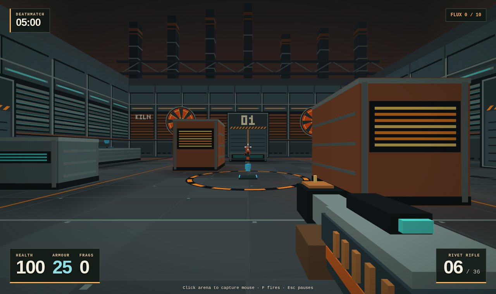

# The Foundry Pit — BS-001 verification

The default-rules Chromium play-through recorded one operator frag and **ten CPU-versus-CPU eliminations**. At combat tick **844**, Kiln eliminated Vise with Arc Repeater shot 24. Kiln reached ten frags at tick **4,884**. Chromium re-executed the recorded commands, matched the full event and state hashes, and started another match while offline. [Match record](played-match.json) · [Accepted commands](played-replay.json) · [All 18 death events](frag-ledger.json)



| Revision | Value |
| --- | --- |
| Merged planning baseline | `90578a457af428722d0980f045f17dc7a1a27b72` |
| Measured game source | `5e04b4b0b5bd3029b5cb046a5673bc7b695a0716` |
| Packaged runtime SHA-256 | `4cad253aac315aead9f9c7e8f954ce4f5abb20b3e657f6eda44d9ab17e9c1913` |
| VANILLAJS v3.2.0 | `7a3a5a3ec49aed5b7063a05614951e69bb257da6` |
| Engine manifest SHA-256 | `396e969f69f745e9267eb3d3f21d052f57e35971b9b0484c02c3247bfebb71e3` |

The runtime digest covers sorted relative paths and their file digests under `content/`, `src/`, `vendor/`, plus `index.html` and `style.css`. The evidence commit adds the recorded results and play-through probe. The PR description identifies the final head.

## What ran

| Check | Observed result |
| --- | --- |
| Local launch | Python 3.12.14 served the repository root with the README command. Chromium entered a four-actor match and the operator eliminated Kiln. [Launch receipt](local-launch.json) |
| Consumer suite | Node v24.22.3 passed 16 tests covering real hits/splash, blocked rays, trades, ammo, armour, pad contention, stairs, safe respawn, ranking, invalid data and clock/replay parity at 30/60/120 Hz. A capacity test filled all 16 actor and 64 projectile slots, checked rejection and recovered the slots after expiry. [Test output](tests.log) |
| Packaged interaction | Chrome Headless Shell 151.0.7922.34 and Python Playwright 1.62.0 opened a cold `/local/pit/` package with external requests blocked. Tests used key presses, pointer lock, relative look, click/held fire, jumping, reload, Tab, release, pause, resume and rematch. The operator won a configurable one-frag match. [Interaction log](browser.json) · [Menu](arena-menu.jpg) · [Victory](victory.jpg) |
| Focus and recovery | D/F key-up events landed in a separate browsing context after blur. Resume accepted fresh input. Hidden-document and pagehide events were injected. Forced WebGL context loss/restoration recovered the paused match. WebGL absence showed a message, and a refused AudioContext allowed play. |
| Repeated matches | Ten restarts retained seven WebGL buffers, one program and one pending game animation callback. Teardown released every tracked buffer, program and audio voice, with zero pending game callbacks. |
| Disconnected match | A warmed local package completed each default-rules run with the browser offline, verified its tape, and rematched. The app uses a local HTTP origin without a service worker. Cold starts and reloads require the local server. [Default reference result](match-results.jpg) |
| Upstream checks | The pinned checkout passed all **1,397** tests, `node scripts/check.js` and `node scripts/build.js`. The first shallow run lacked historical object `ce7e38eb3c7412407a3ba2bc472120b589e6eb9e` for ALIEN-MATH-006. Fetching that exact object and rerunning the full suite resolved the prerequisite. [Full test log](upstream-tests.log.gz) · [Check/build output](upstream-check-build.log) |

## P1 performance

The reference uses the foundry pack, seed **1179603527**, four actor slots and the default limits. The tape begins with input cancellation followed by neutral operator input, while all three rivals run their normal AI. Kiln won at tick **4,220**. The final frag scores were Kiln 10, Flux 4, Vise 4 and Operator 0. [Reference tape](reference-replay.json) · [System and measurement receipt](p1.json)

The hosted Linux system reported an Intel Xeon Platinum 8573C. Chromium used ANGLE/Vulkan SwiftShader, WebGL 1, DPR 1 and a 1920 × 1080 drawing buffer. After 120 warm-up ticks, the sample included 600 individual simulation ticks and 150 callbacks whose ending tick fell within 121–720, covering 11.00 seconds of frame intervals.

| Measured duration | p50 | p95 | p99 |
| --- | ---: | ---: | ---: |
| Render callback interval | 66.7 ms | 133.3 ms | 233.4 ms |
| JavaScript frame callback | 3.8 ms | 7.5 ms | 12.3 ms |
| Individual tick including game feedback | 0.6 ms | 1.4 ms | 3.0 ms |

The five-step catch-up cap discarded 1.000 s of excess wall time. There were 138 intervals over 33.34 ms. Frames submitted 2–4 draws and 10,002–10,722 triangles. There were 2–4 living actors, up to one projectile at frame end, 404 target-sight queries, 10 cover rays and 41 route searches expanding 436 cells in the sampled frames. Submitted geometry includes triangles later clipped or depth-tested. GPU execution time, visible-pixel counts and physical GPU performance were unmeasured. [Raw frame samples](p1-frames.csv) · [Raw tick samples](p1-ticks.csv)

An earlier run on `2ccf7e71508e18a2b9a0add6612492efc1d64b14` produced the same reference state and event digests. Its frame interval p50/p95 also measured 66.7/133.3 ms. The source-bound raw samples are preserved alongside its receipt. [Earlier P1](initial-p1/p1.json)

## Replay scope and reproduction

Chromium verified both browser tapes in the game. Node independently reproduced its own state and event hashes. Using the same arena, seed and reference commands, both engines reached the same scores, deaths and terminal tick. Their Float64 state and event digests differed. Use **Options → Verify saved replay** in the producing browser for a browser tape, or use the matching Node fixture with the CLI. [Node receipt](node-reference-replay.json)

```sh
node --test tests/*.test.mjs
node scripts/verify-replay.mjs evidence/bs-001/node-reference-replay.json
python3 scripts/browser.py --chromium /path/to/chrome-headless-shell --out /tmp/bs001
(cd evidence/bs-001 && sha256sum -c SHA256SUMS)
```

Physical mouse feel, audible mix, native 1080p/60 performance, other browser families and eight-bot scaling remain open. The measured arena has 18 static combat solids, seven admitted bot spawn positions, six supplies and three active bots. The owner play-through is the next acceptance gate.
