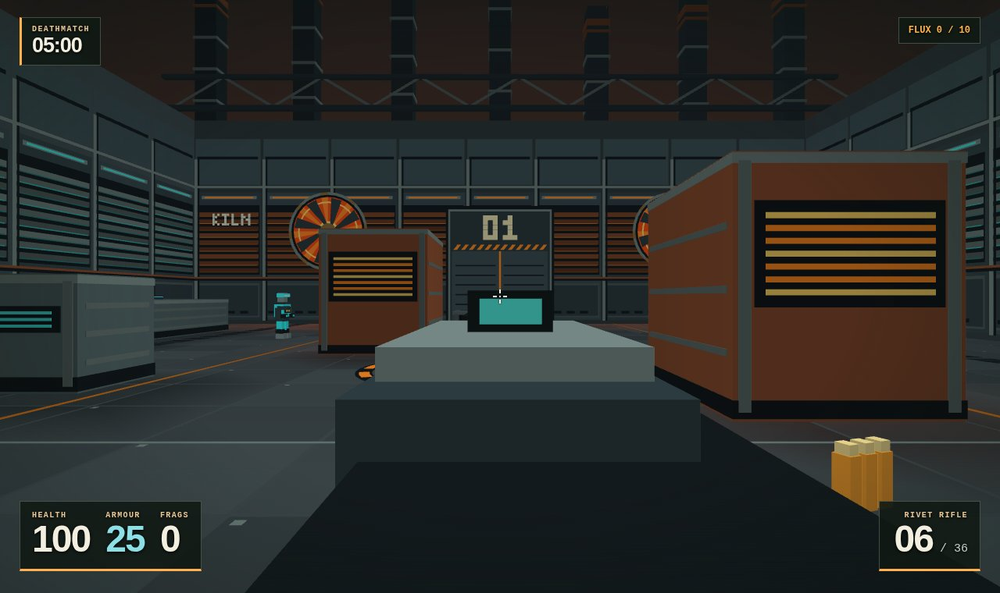

# BS-002 — Foundry Pit verification

## Joining the arena

On the published BS-001 build, Chromium received one click on **Enter the pit** and no other input. At the observed damage sample the player had 8.11 health and zero armour. The mouse was still free and the match had reached tick 70. The Pages source marker identified the deployed merge of PR #3, `a7efda6bc4661e349af5166b646043be72a0fa96`. [Live reproduction](before-capture.json) · [Public game and offline rematch](pages.json)

On BS-002 the same button requests capture during the original mouse gesture. The clock starts once capture is granted and the click is released. The browser probe withheld the first capture result for two seconds, then rejected it. In both trials the game remained at tick zero with four actors at 100 health, zero kills or deaths and an empty replay. Retrying acquired the real browser pointer lock. Choosing drag-to-aim kept the cursor free and a real drag turned the player. A separate held-click trial checked that releasing the button caused neither a shot nor a turn. [Input and restart observations](browser.json) · [Waiting for capture](waiting-for-mouse.jpg)

The documented local HTTP server also served a cold copy at its root. After the first real click, the probe paused a live match and held a second capture request during **Resume**. Positions, health, weapons, camera, scores, projectiles, AI counters and tick stayed fixed for two seconds. A native retry resumed the same match. [Local launch and resume](local-resume.json)

## Movement and combat

Chromium replayed identical accepted input for both movement presets. The operator strafed, reversed and jumped. Both receipts passed the in-game replay implementation. [Commands and measurements](tuning.json)

| Preset | Lateral distance after ten ticks | Ticks to reverse | Jump apex |
| --- | ---: | ---: | ---: |
| Classic | 0.998 m | 7 | 1.267 m |
| Arcade | 1.233 m | 6 | 1.424 m |

The operator eliminated Kiln with the Rivet Rifle. The authoritative event ledger contains **11 eliminations between rival machines**. Kiln reached ten frags at tick 3,619. Chromium verified the saved commands and both digests, then started a fresh match offline. [Played match](played-match.json) · [Death events](frag-ledger.json) · [Importable replay](played-replay.json)



The two scripted opening-shot checks order a trusted F key before the first combat frame so scheduling cannot move the pre-aimed target before the shot. The mouse capture tests, full reference profile and subsequent game frames use the browser's ordinary animation schedule. Browser input also exercised right mouse and Q sights, jump/strafe, reload, focus loss with off-window key release, pointer release, pause/resume, context restoration and the explicit no-audio path. After ten new matches, teardown left zero tracked WebGL buffers, programs, audio voices and pending game frames. Human assessment of the audible mix and mouse feel on physical hardware remains open. [Test log](tests.log) · [Combat HUD](under-fire.jpg)

## 1080p reference

Both runs used the same Chrome Headless Shell 151.0.7922.34 binary, ANGLE/Vulkan SwiftShader, a 1920 × 1080 drawing buffer at DPR 1, and the Foundry Pit pack. The reference starts with seed 1179603527 and an input cancellation followed by neutral operator commands. The three CPU rivals keep playing. The sample covers ticks 121–720, following 120 warm-up ticks.

| Measurement | BS-001 control | BS-002 Arcade |
| --- | ---: | ---: |
| Rendering interval, p50 / p95 | 166.7 / 366.7 ms | 100.1 / 250.0 ms |
| Frame callback, p50 / p95 | 6.3 / 29.5 ms | 9.1 / 18.2 ms |
| Simulation step, p50 / p95 | 0.8 / 6.6 ms | 1.0 / 5.4 ms |
| Sampled callbacks / simulation ticks | 129 / 600 | 135 / 600 |
| Maximum steps per callback | 5 | 5 |
| Dropped wall time | 13.48 s | 5.78 s |

The Arcade reference finished at tick 4,575. Its sample submitted 2–4 draw calls and 10,002–10,734 triangles per frame, with at most one active projectile during the sampling window. [Reference replay](reference-replay.json) · [Final scoreboard](match-results.jpg)

The two rulesets produce different fights. The hosted CPU and software renderer are shared resources and the BS-001 control overlapped other development work. These observations measure callback intervals and JavaScript time. GPU completion, a native 1080p frame rate and a performance gain remain unmeasured. [Control samples](pr2-control/p1.json) · [BS-002 system and counters](p1.json) · [Frames](p1-frames.csv) · [Simulation ticks](p1-ticks.csv)

## Revisions and reproduction

| Source | Revision |
| --- | --- |
| BS-001 control | `63491a0060e7c83e8ca65ba5a3ba6de0d3dfb017` |
| Measured BS-002 game source | `bb9d2d41c829a9bfb2e8b9bdf5dc8d05ff717c66` |
| VANILLAJS v3.2.0 | `7a3a5a3ec49aed5b7063a05614951e69bb257da6` |

The browser records include the exact runtime and executable digests. Node 24.22.3 ran all 28 tests and independently verified the archived 4,220-tick Node replay. Chromium verified its separate 4,220-tick browser fixture through the file input. The replay guarantee applies within each recorded runtime.

```sh
node --test tests/*.test.mjs
node scripts/verify-replay.mjs evidence/bs-001/node-reference-replay.json
python3 scripts/browser.py --chromium /path/to/chromium --suite all --out /tmp/bs002
python3 scripts/browser.py --chromium /path/to/chromium --suite hosted --url https://qsolkcb.github.io/Boomer-Shooter/ --out /tmp/bs002-public
(cd evidence/bs-002 && sha256sum -c SHA256SUMS)
```
